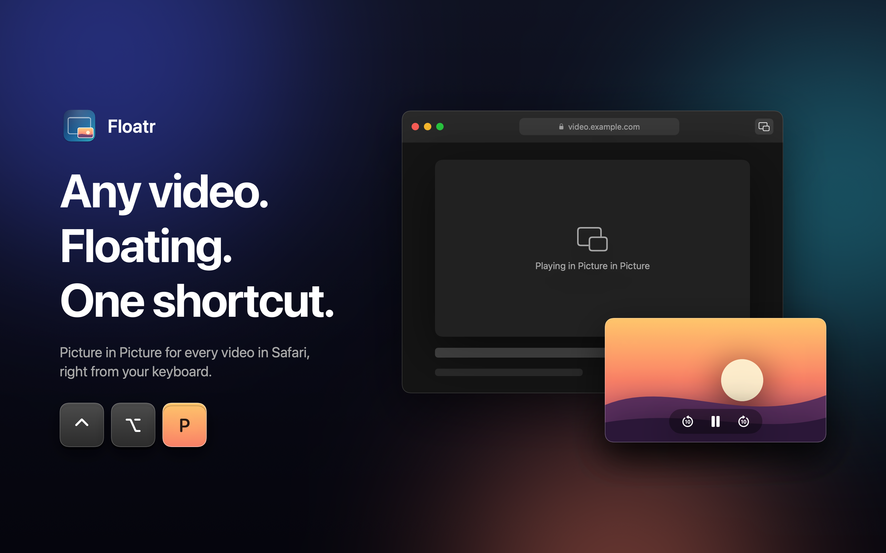
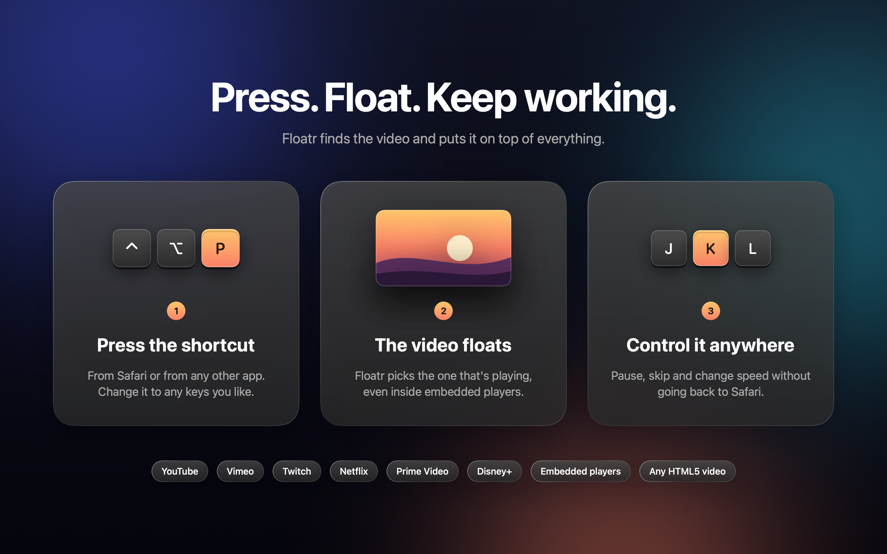
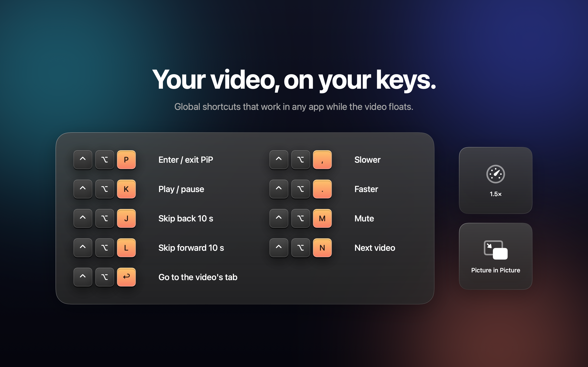
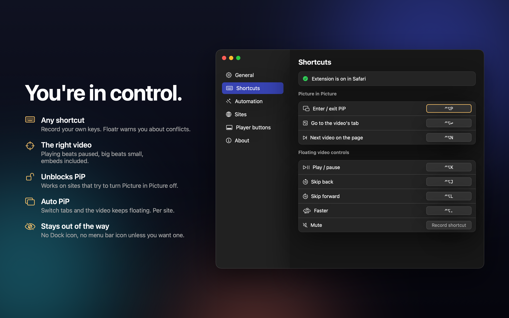

# Floatr

**English** · [Português](README.pt-BR.md)



A Safari extension and a tiny invisible Mac app that put any video in **Picture in Picture** with a keyboard shortcut — from Safari or from any other app — and let you control the floating video without switching windows.

## Screenshots







## Download

Grab **Floatr.zip** from the [latest release](https://github.com/lucashaliax/Floatr/releases/latest), unzip it and drag `Floatr.app` to `/Applications`.

Floatr isn't notarized by Apple, so macOS blocks it the first time you open it. To allow it:

1. Open Floatr once. macOS will say it can't verify the developer; click **Done**.
2. Go to **System Settings → Privacy & Security**, scroll down and click **Open Anyway** next to Floatr.

Or run this once in Terminal:

```bash
xattr -dr com.apple.quarantine /Applications/Floatr.app
```

Then:

1. In Safari, open **Settings → Extensions**, turn on **Floatr** and allow it on all websites.
2. When Floatr asks, allow it in **Accessibility** (it uses this only to click its own toolbar button when a site requires a click).
3. Play a video and press **⌃⌥P**.

If Floatr doesn't show up in Safari's Extensions list, turn on **Safari → Settings → Advanced → Show features for web developers**, then **Develop → Allow Unsigned Extensions**. The app is signed with a personal development certificate, not a Developer ID.

## Shortcuts

| Action | Default |
|---|---|
| Enter / exit Picture in Picture | ⌃⌥P |
| Play / pause | ⌃⌥K |
| Skip back / forward 10 s | ⌃⌥J / ⌃⌥L |
| Slower / faster | ⌃⌥, / ⌃⌥. |
| Mute | ⌃⌥M |
| Next video on the page | ⌃⌥N |
| Go to the video's tab | ⌃⌥↩ |

Every shortcut can be changed in Floatr's settings. The controls work in any app while the video floats.

## Features

- Global shortcuts, recorded like any Mac shortcut, with conflict warnings
- Picks the right video: playing beats paused, big beats small, embedded players included (cross-origin iframes too)
- Toggles: the same shortcut brings the video back
- Unblocks Picture in Picture on sites that disable it
- Auto PiP when you switch tabs, per site
- PiP buttons inside YouTube, Twitch, Vimeo, Netflix, Prime Video, Disney+, Max, Video.js, JW Player, Plyr and Wistia, plus an optional floating button over any video
- "Picture in Picture" in the video's right-click menu
- Per-site rules: buttons, auto PiP, default speed
- On-screen HUD like the system volume indicator
- Runs invisibly (no Dock icon); optional menu bar icon
- Open at login, English and Portuguese interface

## Requirements

- macOS 14 or later
- Safari

## Build from source

Requires Xcode. Open `Floatr.xcodeproj` once and pick your **Team** in *Signing & Capabilities* for both targets (Floatr and Floatr Extension). Then:

```bash
tools/build.sh          # build (Release), install in /Applications, relaunch, check resource use
tools/build.sh --zip    # same, plus build/release/Floatr.zip for a GitHub release
```

Every build ends with `tools/check_resources.sh`, which measures the running app and its extension while idle (memory, CPU, wakeups per second, leaks) and fails on leaks or idle CPU use. `Tests/pages/bench.html` is a heavy page (15,000 elements, constant DOM changes) for timing the content script in a browser.

The project file is generated by `tools/gen_project.py` (run it again after adding or removing Swift files; it keeps your Team). Icons: `swift tools/make_icons.swift`. Translations: `python3 tools/make_strings.py`.

The promo images are generated in code:

```bash
swiftc -O -swift-version 5 Promo/PromoRenderer.swift -o build/promo-render && build/promo-render
```

## How it works

```
global shortcut (Carbon hotkey, no permission needed)
  → Floatr.app → SFSafariApplication.dispatchMessage
  → Floatr Extension (Safari App Extension)
  → content script in the tab (or in the tab whose video is floating)
  → the top frame asks every iframe for its best video
  → the winning frame runs the command
```

Safari only allows Picture in Picture after a user action. When a page refuses the request, the extension tells the app, and the app presses Floatr's own toolbar button through the Accessibility API — the same click a person would make. That's why the button has to stay in Safari's toolbar.

`Tests/pages` has local pages (several videos, a cross-origin iframe) for testing the content script in any browser.

---

Developed by Lucas Haliax
