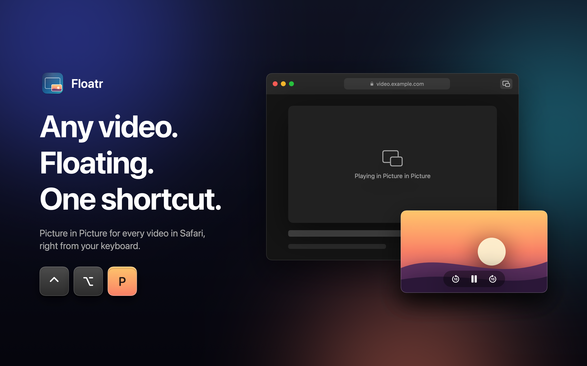
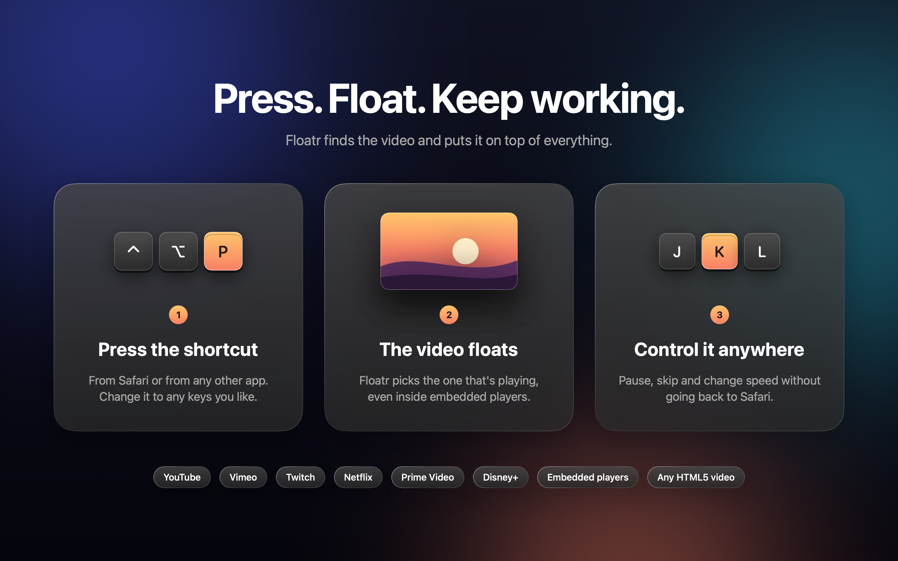
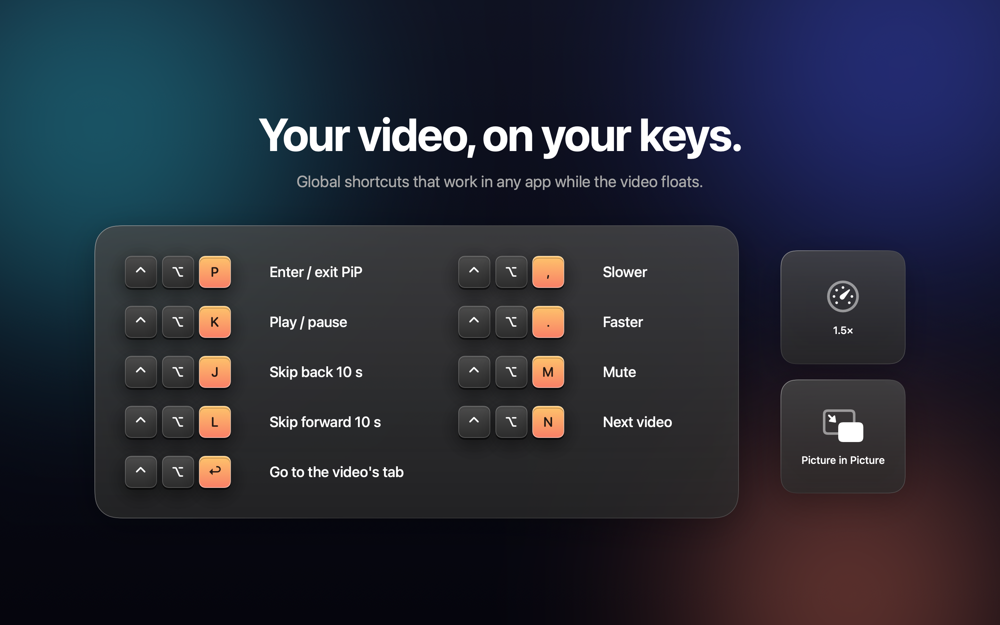
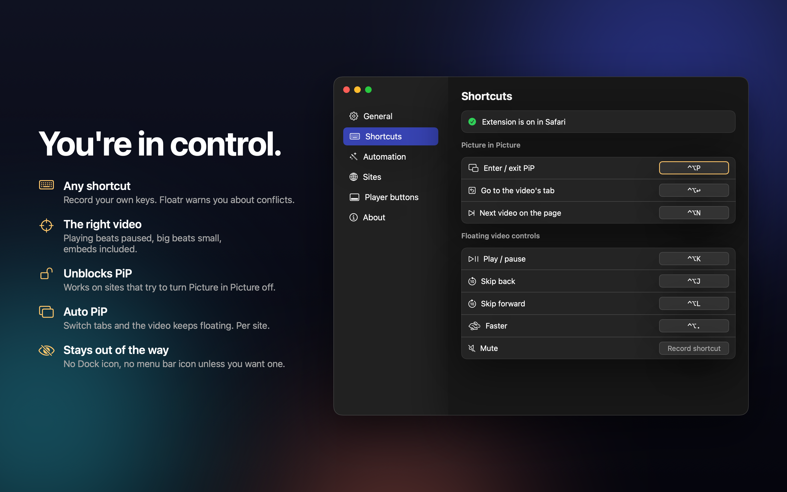

# Floatr

[English](README.md) · **Português**



Uma extensão do Safari e um pequeno app invisível para Mac que colocam qualquer vídeo em **Picture in Picture** com um atalho de teclado — do Safari ou de qualquer outro app — e deixam você controlar o vídeo flutuante sem trocar de janela.

## Screenshots







## Download

Baixe o **Floatr.zip** no [último release](https://github.com/lucashaliax/Floatr/releases/latest), descompacte e arraste o `Floatr.app` para `/Aplicativos`.

O Floatr não é notarizado pela Apple, então o macOS bloqueia a primeira abertura. Para liberar:

1. Abra o Floatr uma vez. O macOS vai dizer que não consegue verificar o desenvolvedor; clique em **OK**.
2. Vá em **Ajustes do Sistema → Privacidade e Segurança**, role até o fim e clique em **Abrir Mesmo Assim** ao lado do Floatr.

Ou rode isto uma vez no Terminal:

```bash
xattr -dr com.apple.quarantine /Applications/Floatr.app
```

Depois:

1. No Safari, abra **Ajustes → Extensões**, ative o **Floatr** e permita em todos os sites.
2. Quando o Floatr pedir, permita em **Acessibilidade** (ele usa isso só para clicar no próprio botão da barra quando um site exige um clique).
3. Dê play num vídeo e aperte **⌃⌥P**.

Se o Floatr não aparecer na lista de extensões do Safari, ligue **Safari → Ajustes → Avançado → Mostrar recursos para desenvolvedores web** e depois **Desenvolvedor → Permitir Extensões Não Assinadas**. O app é assinado com um certificado pessoal de desenvolvimento, não com um Developer ID.

O idioma padrão é inglês; para usar em português, vá em **Geral → Language** e escolha **Português**.

## Atalhos

| Ação | Padrão |
|---|---|
| Entrar / sair do Picture in Picture | ⌃⌥P |
| Play / pausa | ⌃⌥K |
| Voltar / avançar 10 s | ⌃⌥J / ⌃⌥L |
| Mais devagar / mais rápido | ⌃⌥, / ⌃⌥. |
| Silenciar | ⌃⌥M |
| Próximo vídeo da página | ⌃⌥N |
| Voltar para a aba do vídeo | ⌃⌥↩ |

Todos os atalhos podem ser trocados nos ajustes. Os controles funcionam em qualquer app enquanto o vídeo flutua.

## Recursos

- Atalhos globais, gravados como qualquer atalho do Mac, com aviso de conflito
- Escolhe o vídeo certo: o que está tocando, o maior, inclusive dentro de players incorporados (iframes de outros sites também)
- O mesmo atalho tira o vídeo do PiP
- Libera o PiP em sites que o bloqueiam
- Auto-PiP ao trocar de aba, por site
- Botões de PiP dentro de YouTube, Twitch, Vimeo, Netflix, Prime Video, Disney+, Max, Video.js, JW Player, Plyr e Wistia, e um botão flutuante opcional sobre qualquer vídeo
- "Picture in Picture" no menu de clique direito do vídeo
- Regras por site: botões, auto-PiP, velocidade padrão
- HUD na tela como o indicador de volume do sistema
- Roda invisível (sem ícone no Dock); ícone na barra de menus opcional
- Abre ao iniciar a sessão; interface em inglês e português

## Requisitos

- macOS 14 ou posterior
- Safari

## Compilar

Precisa do Xcode. Abra o `Floatr.xcodeproj` uma vez e escolha seu **Team** em *Signing & Capabilities* nos dois alvos (Floatr e Floatr Extension). Depois:

```bash
tools/build.sh          # compila (Release), instala em /Applications, reabre e verifica o uso de recursos
tools/build.sh --zip    # o mesmo, e gera build/release/Floatr.zip para um release no GitHub
```

Todo build termina com `tools/check_resources.sh`, que mede o app e a extensão em repouso (memória, CPU, ativações por segundo e vazamentos) e falha se houver vazamento ou uso de CPU em repouso. `Tests/pages/bench.html` é uma página pesada (15 mil elementos mudando sem parar) para medir o script da página num navegador.

O projeto é gerado por `tools/gen_project.py` (rode de novo ao adicionar ou remover arquivos Swift; ele mantém o Team). Ícones: `swift tools/make_icons.swift`. Traduções: `python3 tools/make_strings.py`. Imagens promocionais:

```bash
swiftc -O -swift-version 5 Promo/PromoRenderer.swift -o build/promo-render && build/promo-render
```

## Como funciona

O atalho global (hotkey Carbon, sem permissão) chega ao app, que manda a mensagem para a extensão do Safari; a extensão encaminha para a aba certa, e o script da página escolhe o melhor vídeo entre todos os frames. Como o Safari só aceita PiP depois de uma ação do usuário, quando a página recusa, o app aperta o próprio botão do Floatr na barra do Safari pela API de Acessibilidade. Por isso o botão precisa ficar na barra.

---

Desenvolvido por Lucas Haliax
